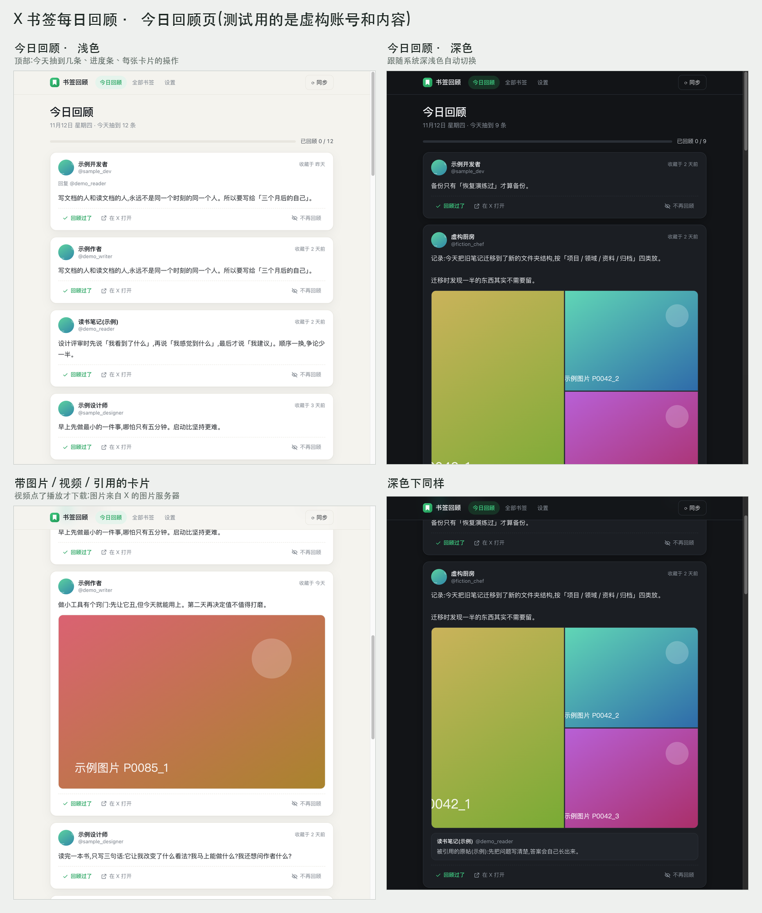

# X 书签每日回顾(Edge 扩展)

每天从你的 X(推特)书签里抽一批回顾。当前版本 **0.2.2**。

- **一次只看一条**：两边是箭头，方向键、触控板左右滑、鼠标按住拖、手机上手指划都能翻页；**翻过去的就算「回顾过了」**。
- **正文复制不误触翻页**：在正文、回复提示、引用正文、链接卡片标题和摘要上拖选文字时，翻页手势自动让位给文字选择（支持 `⌘C` / `Ctrl+C` 复制），触控板在正文区横滑也不会误翻页。
- **可以点赞**（只记在本机），**可以删除**（也只动本机这一份，X 上的书签不受影响，随时能恢复）。
- **图片按合适大小直接显示**，不用点进去看；**文章、链接卡片的标题放大加粗**，不再只是一个链接。
- **固定条数**：在 4、8、12、18、24 条中选一个固定条数，默认 12 条。
- **新旧配比**：约三分之二是尚未回顾的书签，随机抽取；约三分之一是已经回顾过的书签，按遗忘风险排序。每日 4、8、12、18、24 条时，旧内容分别占 1、3、4、6、8 条。一类不够时用另一类补齐。
- **间隔复习**：翻过卡片会记录实际回顾时间。每完成一次回顾，估算的复习间隔会逐步拉长（1、2、4、7、15、30、60 天）。旧版只有展示记录，用上次展示日期作为初始参考。
- **纯本地、零 API 费用**：数据只存在这台电脑的浏览器（IndexedDB）里，不连任何服务器，不用 X 的付费接口密钥。

## 界面预览



## 装进 Edge / Chrome（只需一次）

1. 克隆本仓库（或点击 GitHub 页面右上角 **Code → Download ZIP** 解压到本地固定文件夹）：

```bash
git clone https://github.com/1137109905-byte/x-bookmark-daily-review.git
```

2. 在 Edge 地址栏输入 `edge://extensions`（Chrome 输入 `chrome://extensions`）回车。
3. 打开 **「开发人员模式」** 开关。
4. 点 **「加载解压缩的扩展」**（Chrome 为「加载已解压的扩展程序」），选择刚刚克隆/解压的 `x-bookmark-daily-review` 文件夹。
5. 装好后会自动弹出「今日回顾」页。点工具栏的扩展图标（拼图图标里可以固定出来）随时回到这个页面。

> 卸载就在 `edge://extensions` 同一页点「删除」。

## 如何更新（保留已有书签与回顾记录）

数据存在浏览器的 IndexedDB 里，只要**还用同一个文件夹路径**，更新后书签、回顾次数、点赞与静音状态都会保留：

1. （建议）先在扩展「设置」里点 **导出备份**，存一份 JSON 到本机。
2. 在原仓库目录拉取最新代码（`git pull`），或用新版本文件覆盖到原目录。
3. 打开 `edge://extensions`，找到「X 书签每日回顾」，点击 **重新加载**（不要点「删除」或「清空本机数据」）。

## 第一次使用

1. 先确认这个 Edge 里**已经登录了 X**。
2. 在「今日回顾」页点 **「同步 X 书签」**。扩展会打开 `x.com/i/bookmarks`,自己往下滚动、把整个列表读下来(页面右下角有进度和「停止」按钮)。第一次可能要 1–3 分钟,书签多就更久;期间让那个标签页留在前台。读完标签页会自动关掉。
3. 读完当天就有今日回顾了。之后:
   - 你在 X 上**新点的书签自动收进来**(收藏、取消收藏都会跟着变);
   - 在手机上收藏的,点回顾页右上角的「同步」(或 X 书签页右下角的绿色「同步」按钮)——增量同步,只读到「已知」就停,很快;
   - 想把 X 上**已取消收藏**的也清出回顾池:设置里点「完整同步」。

## 每天怎么回顾

页面上方是进度条和「第 3 / 12 条 · 已回顾 2」,中间是**当前这一条**,左右两边是翻页箭头。

| 操作 | 效果 |
| --- | --- |
| 点右箭头 / 键盘 → / 触控板向左滑 / 鼠标按住往左拖 / 手机上向左划 | 翻到下一条;**离开的这条算「回顾过了」**,角标数字减一 |
| 左箭头 / ← / 反方向 | 退回上一条;退回去**不会**取消已回顾 |
| 最后一条翻过去 | 出现「今天这批回顾完了」:可以「再来 4 条」或「从头再看一遍」,明天自动抽新的 |
| 点赞 | 变成「已赞」,再点取消。**只记在本机,不会去 X 上点赞**;「全部书签」里选「点赞过的」能找到 |
| 不再回顾 | 这条以后不再抽到(「全部书签」里可恢复);下一条顶上来;提示条上有「撤销」 |
| 删除 | 只删本机这一份(留一条记录,不然下次同步又会收回来);**X 上的书签没动**;提示条上有「撤销」,之后也能在「全部书签 → 已删除」里恢复 |
| 在 X 打开 | 去原帖(新标签页) |
| 页面下方「再来 4 条」「重新抽取今天的」 | 想多看点,或换一批(会尽量避开刚才那批) |

- 以**本地时间的 0 点**换日;标签页开过夜,切回来会自动换成新一天。
- 「出现次数」只在你真正打开页面看到时才记,没看的一天不会算进去。
- 图标上的角标是「今天还剩几条没回顾」。
- 图片整张显示(不裁切):太高的竖图限制在一屏左右,超宽图按比例缩小;很长的卡片往下滚时,左右箭头会跟着停在视野中间。
- 带链接的帖子会显示**链接卡片**(标题、摘要、域名、封面),X 长文章会显示**文章卡片**(标题、导语、封面),点卡片去原文。

## 设置

- 每天回顾几条(4、8、12、18 或 24 条);新条数从明天起生效,想马上换用「重新抽取今天的」。
- 每日提醒(默认 09:00):到点弹一条系统通知,点开就是今日回顾。如果没弹,检查系统设置里是否允许 Edge 发通知。
- 每天第一次打开浏览器时自动打开今日回顾(默认关)。
- 备份:导出成 JSON(回顾次数、静音、点赞、删除状态都带上),换电脑时导入。「清空本机数据」只删扩展里的副本,不影响 X 上的书签。

## 它是怎么读到书签的 / 隐私

X 的官方接口要付费,所以扩展不用它。做法是:在你**已登录**的 `x.com` 页面里,旁听页面自己发给 X 服务器的书签请求结果(只看「书签列表」「收藏 / 取消收藏」相关的),解析后存进本机 IndexedDB;自动同步时只是替你把书签页往下滚。文章、链接卡片的标题也是从同一份数据里读的。

- 权限:`storage` / `unlimitedStorage`(存书签)、`alarms`(每日提醒和午夜换日)、`notifications`(提醒)、`x.com` / `twitter.com` 页面(读书签数据)。没有别的网站权限,没有任何对外请求。
- 点赞、删除**不会向 X 发出任何请求**。
- 页面里显示的内容一律按纯文本渲染,图片只允许来自 X 的图片服务器;卡片的跳转链接只认 http(s)。
- X 限速(HTTP 429)时会自己等 65 秒再继续,最多三次,然后停下并提示。

## 已知局限

- **链接卡片、X 长文章的标题,是按我对 X 数据格式的了解写的,没有在真正的 X 上验证过**(测试用的是照着这个格式做的「假 X」)。万一 X 的格式不一样,最坏情况是读不到标题——这条书签仍然照常显示正文和链接,不会出错;请你装好后看一眼带文章的书签,告诉我标题有没有出来。
- 点赞和删除只在本机,**没有同步到 X**(X 上不会跟着点赞或取消收藏)。如果你希望同步过去,需要扩展去操作你的 X 页面,有一定风险,先问你再做。
- 依赖 X 网页现在的数据格式。X 改版导致读不懂时,扩展会**自动退回读取页面上的文字**(能读到作者、正文、卡片标题、时间,图片只有页面上已显示的),并提示你;这种情况下不会据此清理「已取消的书签」。
- 视频只存了封面和 mp4 地址;点播放时才去 X 的服务器下载。
- 很长的串推(thread)只收这一条,不展开整串。
- 同步读的是「全部书签」列表;已删除、受保护账号的帖子(X 只给一块「已不可用」的墓碑)会被跳过。

## 实测情况(2026-11-12)

- 单元测试 36 个全部通过:`node --test "tests/*.test.js"`(Node 22,零依赖)。
- 端到端 25 个场景全部通过(连跑多轮都过,每轮的随机抽取不同):`node tests/e2e/run.js`。它带着本扩展启动 Chrome for Testing,把 x.com 指到本机的「假 X」,真的跑一遍:
  - 同步:首次同步 87 条(含长帖、图、视频、引用、墓碑、链接卡片、长文章)→ 浏览书签页时顺手收进来 → 点页面右下角同步按钮 → 增量/完整同步 → 实时收藏 → 换日 → 提醒闹钟 → 备份恢复 → X 改版兜底 → 403 出错 → 没登录;
  - 回顾页(一次一条):箭头位置、点箭头 / 方向键 / 触控板横滑 / 鼠标拖动 / 手指划动都能翻页且记为已回顾,往回翻不取消,短拖和竖拖不翻页,点赞(并确认没有对 X 发任何请求),不再回顾和删除的撤销能放回原位,看完页、再来 4 条、重新抽取,旧书签补标题的提示,更新后删除过的书签不会被同步收回来;
  - 显示:链接和文章标题的字号与完整度、封面加载、竖图/超宽图/四张图的缩放(整张显示、不超高、不溢出)、长卡片滚动时箭头仍在视野、视频点开才下载并能真播放、深色模式、手机宽度不溢出;
  - 并截图(整理后的预览在「预览截图/」)。
- 这轮测试还抓到并修好一个真问题:「全部书签」里连着切换筛选时,两次请求的结果会拼在一起。
- **没有在真正的 x.com 上测过**(需要你的登录),也没有在真实的 Edge 里点过;系统通知在无头浏览器里发不出来,只验证了「到点触发、记录、排下一次」;X 限速(429)那段 65 秒等待也没跑(太久)。
- 手指划动是用浏览器的触摸模拟测的,不是真手机。
- 端到端测试用 `--no-proxy-server` 启动浏览器:本机若开着系统代理,不关的话 x.com 会绕过假服务器、真的发给代理。
- 需要的环境:Chrome for Testing(Playwright 的缓存里有;新版 Edge / Chrome 正式版已禁止命令行加载扩展,所以不能用它们)、openssl;有 ffmpeg 还会多测一项视频播放。

## 文件地图

```
manifest.json        扩展清单(Manifest V3)
background.js        后台:入库、每日计划、点赞/删除/撤销、同步调度、角标、提醒
app.html/.css/.js    「今日回顾 / 全部书签 / 设置」页面(今日回顾是一次一条的翻页)
content/hook.js      在 x.com 页面里旁听书签请求(MAIN world,不改任何请求)
content/bridge.js    解析入库、实时收藏、自动滚动同步、页面右下角提示
lib/parse.js         X 数据解析(新旧两种结构、长帖、t.co 展开、链接卡片、长文章、墓碑……)
lib/plan.js          每日抽取(新旧配比、间隔复习、固定条数、换日、提醒时间)
lib/db.js            IndexedDB 封装
icons/               图标
tests/               单元测试 + 端到端(mock-x.js 是假 X,run.js 是驱动脚本,compose_previews.py 把截图拼成预览图)
预览截图/            界面预览图
```
